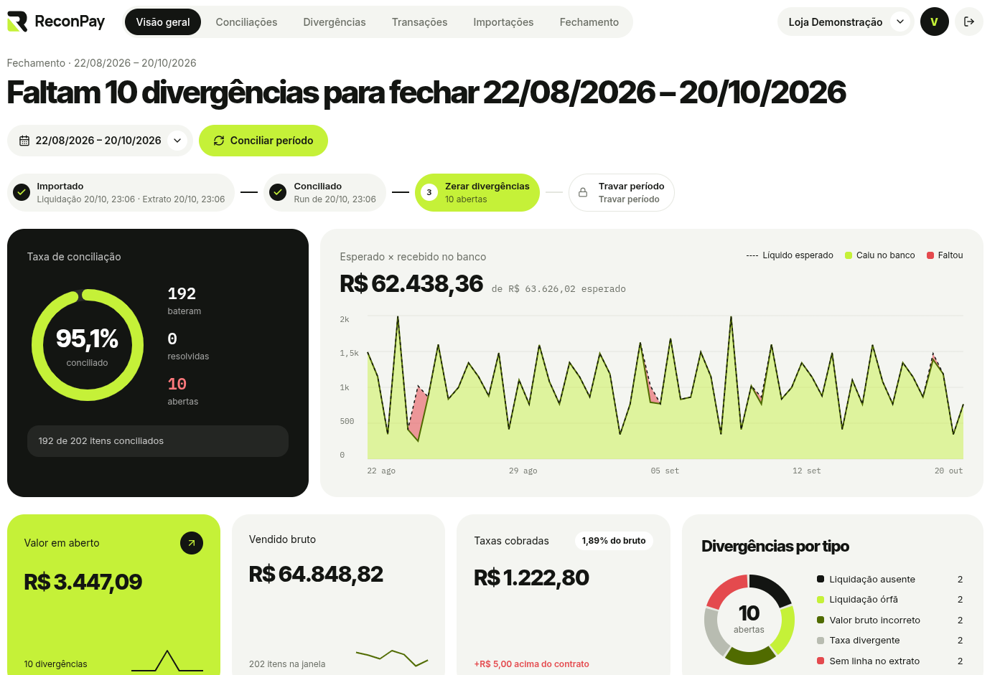
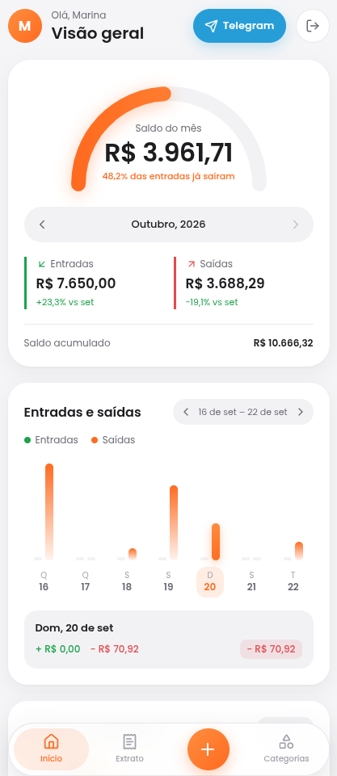
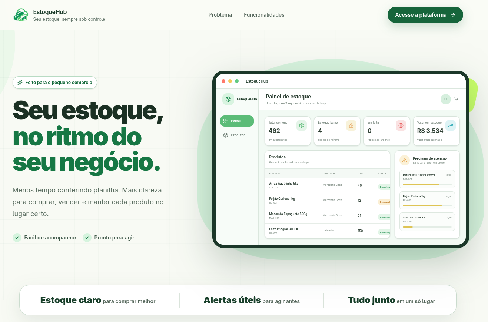
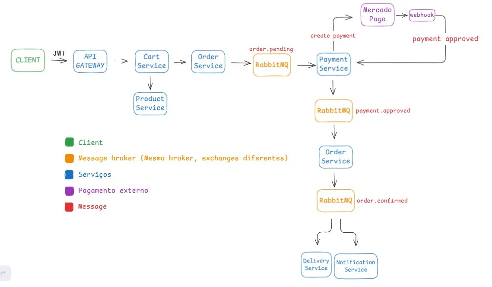

<h1 align="center">Hanrry Santos</h1>
<h3 align="center">Desenvolvedor Backend Java</h3>

  
  
  

## Sobre Mim

Estudante de Engenharia de Software na UEPA (conclusão prevista para 2028), buscando minha primeira oportunidade como desenvolvedor backend (estágio ou júnior).

- **FullDev**: atuei como desenvolvedor backend Java voluntário no **CodaComigo**, um app de relacionamento para pessoas da área de tecnologia. Entreguei mais de 10 endpoints REST, com Spring Security + JWT, PostgreSQL e Flyway.
- **Deefy**: liderei uma equipe de 4 devs backend em um projeto acadêmico da UEPA, uma plataforma de streaming musical. Desenvolvi as APIs de autenticação e playlists e documentei os contratos com Swagger para integração com o frontend. \
  Repositório: [github.com/eng-software-t2024/deefy](https://github.com/eng-software-t2024/deefy)
- **Google Student Ambassador 2026**: programa do Google para universitários, focado em IA generativa e Gemini.
- **PET Clima e Saúde**: projeto de extensão da UEPA com pesquisa e ações nas Unidades Básicas de Saúde de Parauapebas, no Pará.

## Tecnologias

**Backend:** Java, Spring Boot, Spring Data JPA, Spring Security, Spring Batch, Hibernate, Node.js \
**Frontend:** React, Next.js \
**Banco de Dados:** SQL, PostgreSQL, MongoDB, Redis, Flyway \
**APIs e Segurança:** API REST, OpenAPI/Swagger, JSON, OAuth, JWT \
**Mensageria:** RabbitMQ, Kafka \
**Testes e Qualidade:** JUnit 5, Mockito, MockMvc, JaCoCo, k6, SonarQube \
**DevOps e Cloud:** Docker, GitHub Actions (CI/CD), AWS, Linux, Git, GitHub, Maven \
**Observabilidade:** Spring Actuator, Prometheus, Grafana \
**Boas Práticas:** POO, SOLID, Clean Architecture, Design Patterns \
**Metodologias Ágeis:** Scrum, Kanban \
**IA no Desenvolvimento:** GitHub Copilot, Claude, ChatGPT

## Projetos em destaque

> ℹ️ As APIs do Inventory Manager e do E-commerce estão no plano gratuito do Render e podem hibernar. O primeiro acesso pode levar ~30–60s (cold start); recarregue a página se necessário.

### ReconPay - Plataforma de Conciliação Financeira

[Demo](https://reconpay.vercel.app) · [Repositório](https://github.com/hanrrysantos/reconpay) · [Swagger](https://reconpay.hanrry.top/swagger-ui.html)

Cruza as vendas registradas pela empresa com os arquivos de liquidação do adquirente e aponta o que não bate: taxa errada, valor divergente, venda sem pagamento e liquidação sem venda.
- **Destaques:** conciliação assíncrona com snapshot dos dois lados para auditoria, importação de CSV com validação linha a linha, isolamento por merchant com RBAC e JWT, controle de concorrência com lock otimista e conta de demonstração com dados prontos.
- **Produção:** AWS Lightsail com Nginx e Docker Compose, CI/CD no GitHub Actions com scan OWASP e cobertura mínima de 85%.
- `Java 21` · `Spring Boot 3` · `Next.js` · `PostgreSQL` · `Flyway` · `Testcontainers` · `Docker` · `AWS`

### CDG - Controle de Gastos com Telegram e IA

[Repositório](https://github.com/hanrrysantos/controle-de-gastos)

  
  

App de finanças pessoais em que o usuário registra gastos mandando mensagem no Telegram, como "almoço 35 reais". O Gemini interpreta a mensagem, o bot pede confirmação e o lançamento aparece no dashboard.
- **Destaques:** integração com Gemini com fallback automático entre modelos, Telegram Mini App com validação da identidade assinada pelo Telegram, metas mensais por categoria e dados isolados por usuário com JWT.
- `Java 21` · `Spring Boot 4` · `Gemini API` · `Telegram Bot API` · `React` · `TypeScript` · `MySQL`

### Inventory Manager - Controle de Estoque por Lote

[Demo](https://controle-de-estoque.hanrry.top) · [Repositório](https://github.com/hanrrysantos/inventory-manager) · [Swagger](https://api-controle-de-estoque.hanrry.top/swagger-ui/index.html)

Controla o estoque por produto e lote, consome primeiro o que vence antes (FEFO) e avisa por e-mail quando um produto fica abaixo do mínimo.
- **Destaques:** proteção contra consumo concorrente com lock pessimista, testada em PostgreSQL real com Testcontainers; consumo FEFO em vários lotes com rollback total se faltar saldo; fila de reposição no RabbitMQ com idempotência, retentativas e DLQ; relatório de reposição em PDF enviado por e-mail.
- `Java 21` · `Spring Boot 3` · `React` · `TypeScript` · `PostgreSQL` · `RabbitMQ` · `Testcontainers` · `Flyway`

### E-commerce - Plataforma em Microsserviços

[Repositório](https://github.com/hanrrysantos/e-commerce-microsservicos) · [Swagger](https://ecommerce-api-gateway-to0z.onrender.com/swagger-ui.html)

Simula o fluxo completo de uma compra em 9 microsserviços: login, catálogo, carrinho, pedido, pagamento PIX pelo Mercado Pago, entrega e notificação por e-mail.
- **Destaques:** eventos no RabbitMQ encadeando pedido, pagamento e confirmação (`order.pending` → `payment.approved` → `order.confirmed`); confirmação do pagamento por webhook do Mercado Pago; API Gateway com validação de JWT e Swagger centralizado; um banco PostgreSQL por serviço e OpenFeign para as consultas síncronas.
- `Java 21` · `Spring Boot 3` · `Spring Cloud Gateway` · `RabbitMQ` · `PostgreSQL` · `Mercado Pago API` · `Docker` · `GitHub Actions`
